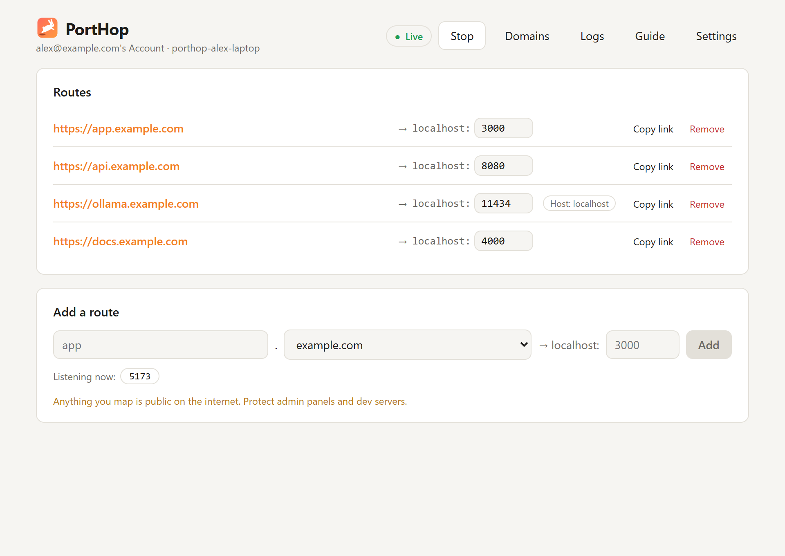
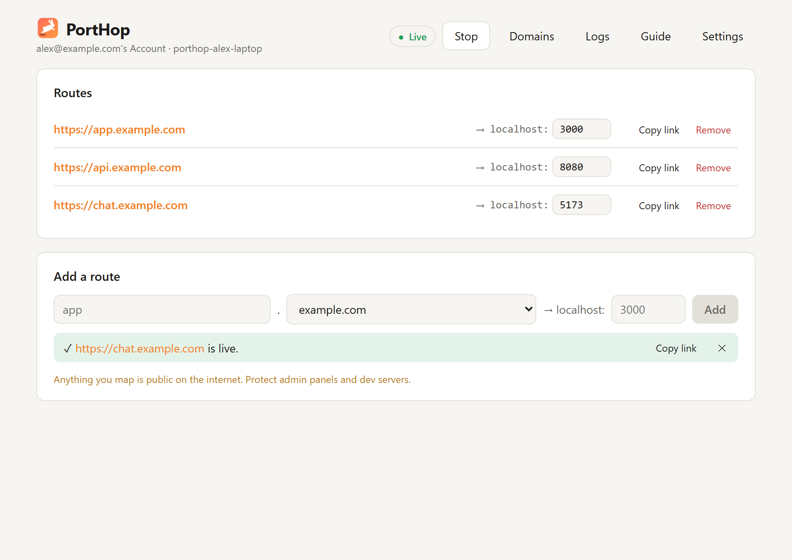
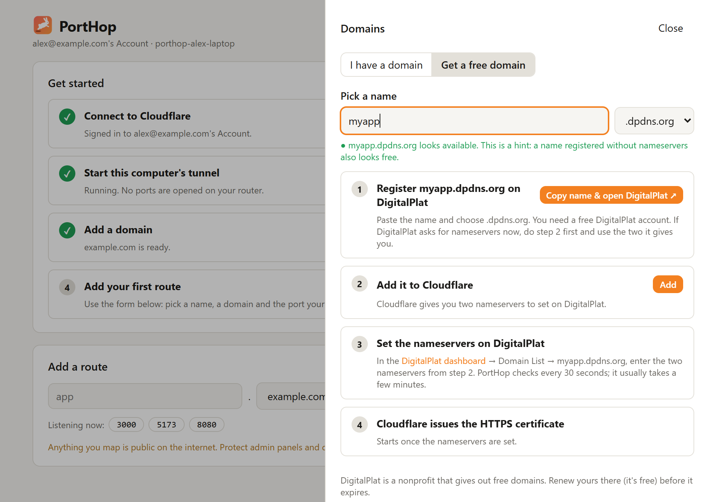
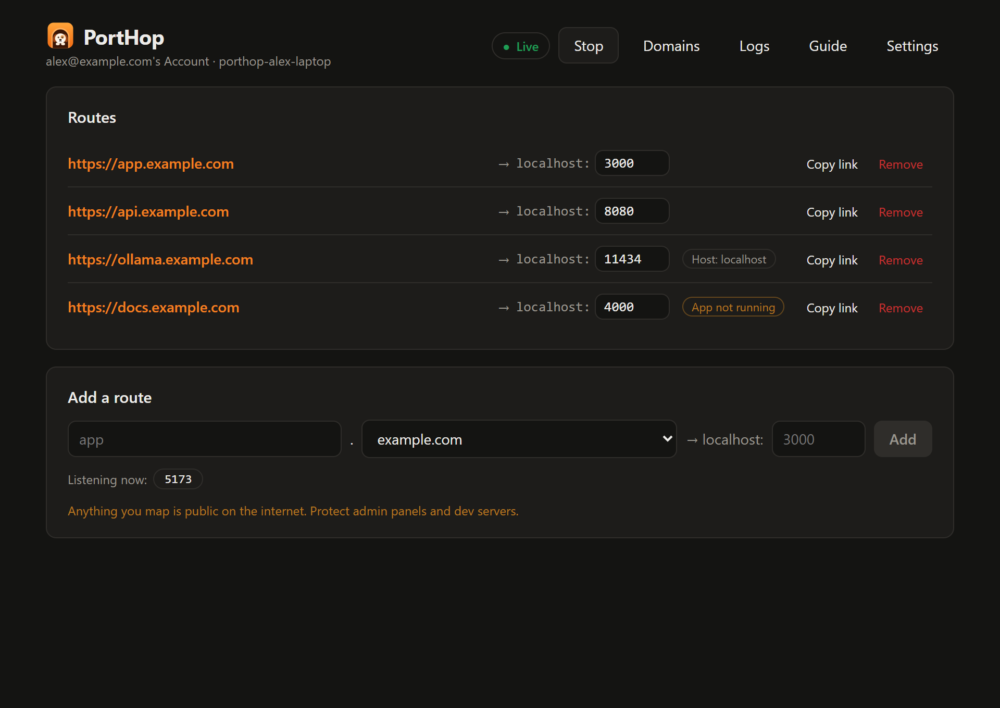
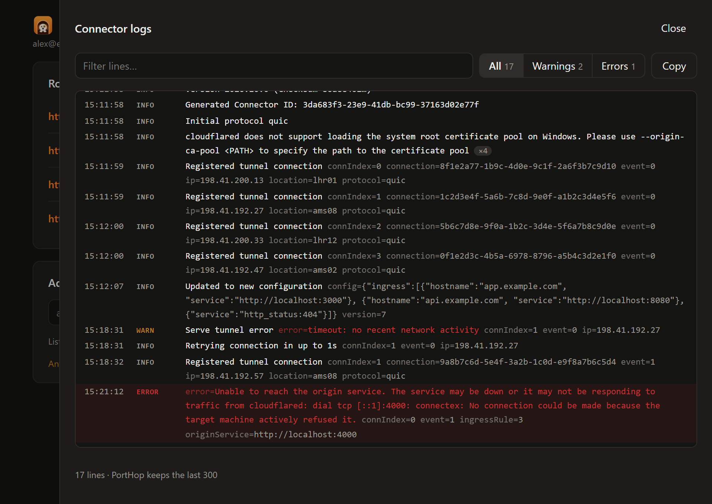
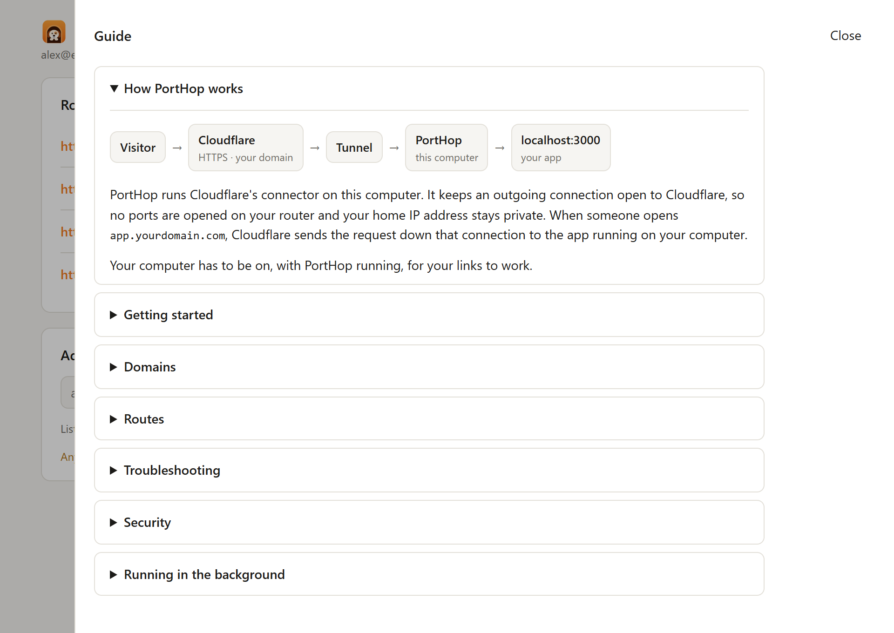
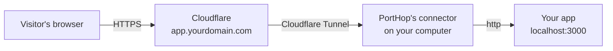
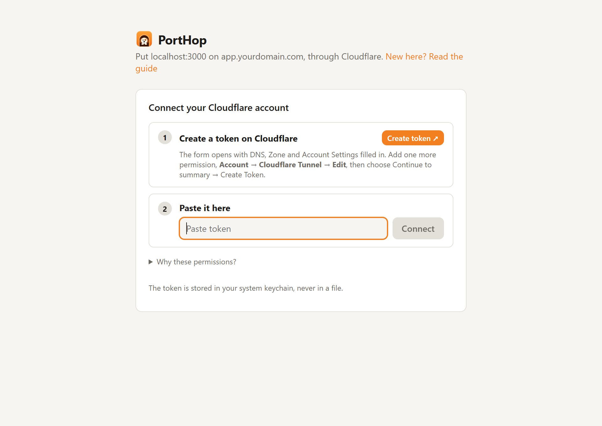
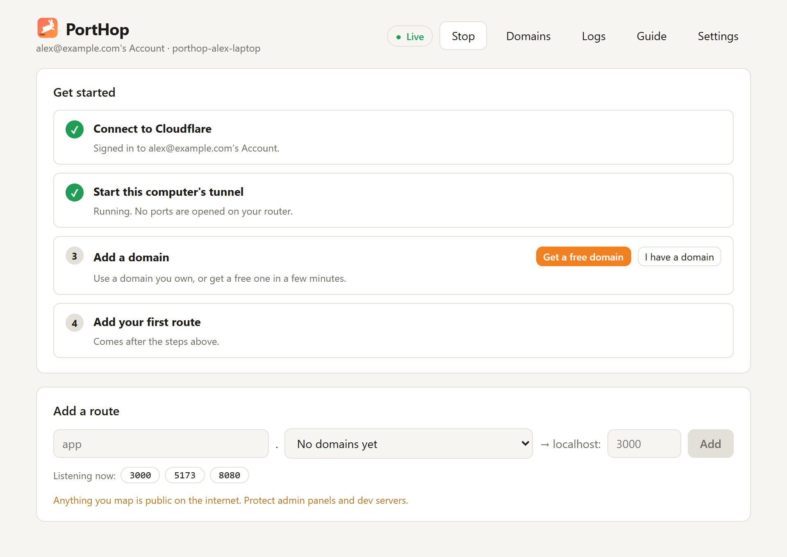

<p align="center">
  
</p>

<h1 align="center">PortHop</h1>

<p align="center">
  <strong>Put apps running on your computer on your own domain, in one hop.</strong><br />
  <code>localhost:3000</code> → <code>https://app.yourdomain.com</code> through a Cloudflare Tunnel. No router ports, HTTPS included.
</p>

<p align="center">
  <a href="https://github.com/mayankjonwal02/Porthop/releases/latest"></a>
  
  <a href="LICENSE"></a>
  
</p>

<p align="center">
  
</p>

PortHop is a desktop app that gives the apps on your computer real public addresses on a domain you own. Pick a subdomain, pick a port, and PortHop sets up the Cloudflare Tunnel routing and DNS for you, then checks the link actually loads before it shows it to you. It runs quietly in the system tray, reconnects on its own, and tells you plainly when something needs your attention.

## Contents

- [Why PortHop](#why-porthop)
- [Features](#features)
- [How it works](#how-it-works)
- [Download](#download)
- [Quick start](#quick-start)
- [Free domains](#free-domains)
- [Troubleshooting](#troubleshooting)
- [Security and privacy](#security-and-privacy)
- [FAQ](#faq)
- [Build from source](#build-from-source)
- [Contributing](#contributing)
- [Code signing policy](#code-signing-policy)
- [License and credits](#license-and-credits)

## Why PortHop

- **Your own domain, not a random one.** Share `https://demo.yourname.dev`, not a throwaway address that changes every time.
- **Free to run.** Cloudflare Tunnel is included in Cloudflare's free plan. No domain yet? PortHop walks you through getting a free one.
- **Nothing to open on your router.** Your computer only makes outgoing connections to Cloudflare, and your home IP address stays private.
- **HTTPS out of the box.** Cloudflare's free certificate covers `yourdomain.com` and names like `app.yourdomain.com`; PortHop waits until it's issued before it lets you use a new domain.
- **It checks its own work.** A route only appears once PortHop has confirmed `https://…` loads through Cloudflare, and every route shows *App not running* if the app behind it stops.
- **A real app, not a config file.** No YAML, no command line: point, click, share.

## Features

### Routes that are checked before they're listed

Type a name, choose a domain and the port your app runs on. PortHop checks the app is running, sets up the tunnel route and the DNS record, then loads the link through Cloudflare. Only if that works does the route appear, with **Copy link** ready. If any step fails, PortHop undoes the earlier ones and tells you why, right under the form.

<p align="center"></p>

- **Common dev-server ports that are listening right now** are suggested as one-click chips.
- **Apps that only answer to `localhost`** (Ollama, Vite, Django, Rails…) are detected automatically; PortHop has the tunnel send them `Host: localhost` and tags the route.
- **Change a port** by editing the number; **remove** a route and its DNS record goes with it.

### Your own domain, or a free one

Add a domain you own and PortHop shows the two Cloudflare nameservers to set at your registrar, then follows it until it's live. Or get a free `.dpdns.org`, `.us.kg`, `.qzz.io` or `.xx.kg` domain from [DigitalPlat](https://domain.digitalplat.org/), step by step. PortHop tracks both stages, the nameservers and then Cloudflare's HTTPS certificate, and only offers the domain for routes once both are done.

<p align="center"></p>

### Status you can trust

- A **Live / Connecting / Stopped** indicator, with a banner when the tunnel is stopped ("your 4 routes are offline") or reconnecting (with the reason).
- **App not running** on any route whose local port has nothing listening.
- **Readable connector logs**: times, levels, errors highlighted, repeated lines collapsed, filters and search, one-click copy.

<p align="center">&nbsp;</p>

### Made to stay out of the way

- **Runs in the system tray.** Closing the window keeps your links up; quit from the tray menu.
- **Starts when you log in** if you want it to, and brings your tunnel back up.
- **Reconnects by itself** if the connection drops.
- **Light, dark or system theme.**
- **A built-in guide** that explains how it works and how to fix the common problems.

<p align="center"></p>

## How it works



PortHop runs Cloudflare's connector ([cloudflared](https://github.com/cloudflare/cloudflared)) on your computer, bundled as `porthop-cloudflared`. The connector keeps an **outgoing** connection open to Cloudflare. When someone opens one of your routes, Cloudflare terminates HTTPS at its edge and sends the request down that connection, and the connector hands it to `http://localhost:<port>`.

Everything else is done through Cloudflare's API with a token you create: one tunnel per computer (named after the computer), its routing rules, and a DNS record for each route.

## Download

Get the installer for your system from the **[latest release](https://github.com/mayankjonwal02/Porthop/releases/latest)**:

| System | File |
| --- | --- |
| Windows 10/11 | `PortHop_<version>_x64-setup.exe` (or the `.msi`) |
| macOS, Apple Silicon (M1 and later) | `PortHop_<version>_aarch64.dmg` |
| macOS, Intel | `PortHop_<version>_x64.dmg` |
| Linux, any distribution | `PortHop_<version>_amd64.AppImage` |
| Ubuntu / Debian | `PortHop_<version>_amd64.deb` |
| Fedora / openSUSE | `PortHop-<version>-1.x86_64.rpm` |

**First launch:**
- **macOS:** the app isn't notarized by Apple yet, so right-click PortHop in Applications → **Open** → **Open** (or System Settings → Privacy & Security → **Open Anyway**).
- **Windows:** if "Windows protected your PC" appears, choose **More info** → **Run anyway**.
- **Linux:** make the AppImage executable (`chmod +x PortHop_*.AppImage`) and run it. On GNOME, the tray icon needs AppIndicator support, which Ubuntu has turned on by default.

**Requirements:** macOS 11 or later; Ubuntu 22.04 or a similarly recent Linux; a free [Cloudflare account](https://dash.cloudflare.com/sign-up).

## Quick start

<p align="center">&nbsp;</p>

1. **Connect Cloudflare.** Click **Create token ↗**: Cloudflare's token form opens with DNS, Zone and Account Settings already filled in. Add one more permission, **Account → Cloudflare Tunnel → Edit**, create the token, and paste it into PortHop. PortHop then creates this computer's tunnel by itself.
2. **Add a domain.** Choose **Get a free domain** or **I have a domain** and follow the steps until the domain shows as **Active**.
3. **Start your app** on your computer, for example on port 3000.
4. **Add a route:** type a name (`app`), pick the domain, enter the port, click **Add**.
5. **Share the link** with **Copy link**. That's it.

The **Get started** checklist on the main screen walks you through the same steps.

## Free domains

[DigitalPlat FreeDomain](https://domain.digitalplat.org/) is a nonprofit that gives out free domains. In **Domains → Get a free domain**, PortHop:

1. Checks whether the name you want looks available, by asking DigitalPlat's own nameservers. That's a hint: a name someone registered without nameservers also looks free.
2. Copies the name and opens DigitalPlat's dashboard so you can register it (you need a free DigitalPlat account).
3. Adds the domain to your Cloudflare account and shows the two nameservers to enter on DigitalPlat.
4. Waits until the nameservers and the HTTPS certificate are in place.

Free domains have to be renewed on DigitalPlat (for free) before they expire.

## Troubleshooting

| What you see | What it means and what to do |
| --- | --- |
| "This site can't be reached" right after adding a route | Your network looked the name up before it existed and remembers "doesn't exist" for up to 30 minutes. Wait, turn on secure DNS in your browser, restart your router, or run `ipconfig /flushdns`. Avoid opening a link before its route exists. |
| HTTP 403 "Access denied" | The app refused the request. If it only answers to `localhost`, remove the route and add it again so PortHop can detect that. Otherwise the app wants a login or only allows certain sites. |
| 502 Bad gateway | Nothing is answering on that port. Start the app; the *App not running* tag clears by itself. |
| Cloudflare error 1033 or HTTP 530 | The tunnel isn't connected. Check the status at the top, press **Start**, and look in **Logs** for the reason. |
| A domain stays "Waiting for HTTPS certificate" | Cloudflare issues it after the nameservers are set, usually within 15 minutes to a few hours. |
| A token or permission error | PortHop needs Cloudflare Tunnel: Edit, Account Settings: Read, DNS: Edit and Zone: Edit, for all zones. Edit the token in Cloudflare and paste it again. |

The in-app **Guide** has the same answers, plus more detail.

## Security and privacy

- **Everything you route is public on the internet.** Don't route admin panels, databases or development tools unless they have their own login. For extra protection, put a route behind [Cloudflare Access](https://developers.cloudflare.com/cloudflare-one/policies/access/).
- **Your API token stays on your computer**, in the system keychain (Windows Credential Manager, macOS Keychain, or the Secret Service on Linux), and is only ever sent to Cloudflare. Signing out removes it.
- **No analytics or telemetry.** PortHop talks to Cloudflare (to manage and serve your routes), to public DNS resolvers from Cloudflare and Google (to check your routes and domains work), and to DigitalPlat's nameservers (only when you check a free domain name). See the [privacy section of the code signing policy](CODE_SIGNING_POLICY.md#privacy-policy).
- **The connector ends with PortHop.** On Windows it ends the moment PortHop does, even after a crash or a force-close; on macOS and Linux a leftover connector is ended the next time PortHop starts. Either way your sites don't quietly stay online without PortHop.
- **Found a security problem?** Please report it privately; see [SECURITY.md](SECURITY.md).

## FAQ

**Is it free?** PortHop is free and open source (MIT). Cloudflare Tunnel is free on Cloudflare's free plan. You need a domain, either one you own or a free one from DigitalPlat.

**Does my computer need to stay on?** Yes. Your routes are served from your computer, so they're online while it's on and PortHop is running.

**Can I use several computers?** Yes. Each computer gets its own tunnel, named after the computer.

**I already use `cloudflared` myself. Will PortHop interfere?** No. PortHop runs its own copy, named `porthop-cloudflared`, with its own tunnel, so your existing setup is left alone.

**Which apps can I share?** Anything that serves HTTP on your computer: dev servers, dashboards, self-hosted tools, local AI models. PortHop forwards to `http://localhost:<port>`.

## Build from source

You need [Node.js](https://nodejs.org/) 20+, [Rust](https://rustup.rs/) and the [Tauri prerequisites](https://v2.tauri.app/start/prerequisites/) for your system.

```sh
npm install          # also downloads the connector for your platform
npm run tauri dev    # run the app in development
npm run tauri build  # build installers into src-tauri/target/release/bundle/
```

Tests: `npx tsc --noEmit` for the interface and `cargo test` in `src-tauri/` for the core; `cargo test -- --include-ignored` also runs the tests that talk to Cloudflare and DigitalPlat.

<details>
<summary><strong>How the code is organised</strong></summary>

| Path | What it does |
| --- | --- |
| `src/App.tsx` | The interface: setup, routes, domains, logs, settings |
| `src/Guide.tsx` | The in-app guide |
| `src/theme.ts` | Light / dark / system theme |
| `src-tauri/src/commands.rs` | Everything the interface can ask the app to do |
| `src-tauri/src/cloudflare.rs` | Cloudflare API client: tunnels, routing rules, DNS, domains |
| `src-tauri/src/connector.rs` | Runs and supervises the bundled connector, parses its logs |
| `src-tauri/src/guard.rs` | Makes sure the connector never outlives PortHop |
| `src-tauri/src/verify.rs` | End-to-end route checks, HTTPS certificate checks, `localhost`-only app detection |
| `src-tauri/src/freedomain.rs` | Free-domain availability checks against DigitalPlat's nameservers |
| `src-tauri/src/doh.rs` | DNS-over-HTTPS lookups that bypass stale local caches |
| `src-tauri/src/ports.rs` | Finds which local ports have something listening |
| `src-tauri/src/secrets.rs` | Stores the API token in the system keychain |
| `src-tauri/src/tray.rs` | Tray icon and menu |
| `scripts/fetch-cloudflared.mjs` | Downloads and verifies the connector for each platform |

</details>

Installers for every system are built by GitHub Actions; see [docs/RELEASING.md](docs/RELEASING.md).

## Contributing

Issues and pull requests are welcome. Before opening a pull request, please run `npx tsc --noEmit` and `cargo test`, and keep the interface text plain and specific: say what happened and what to do next.

## Code signing policy

Windows releases are being set up for free code signing through SignPath Foundation's program for open-source projects. See the [code signing policy](CODE_SIGNING_POLICY.md).

## License and credits

PortHop is released under the [MIT License](LICENSE).

- Bundles [cloudflared](https://github.com/cloudflare/cloudflared) by Cloudflare, Inc. (Apache License 2.0), renamed to `porthop-cloudflared`. See [THIRD_PARTY_NOTICES.md](THIRD_PARTY_NOTICES.md).
- Free domains by [DigitalPlat FreeDomain](https://domain.digitalplat.org/).
- Built with [Tauri](https://tauri.app/), [React](https://react.dev/) and [Rust](https://www.rust-lang.org/).

PortHop is not affiliated with or endorsed by Cloudflare. "Cloudflare" is a trademark of Cloudflare, Inc.
